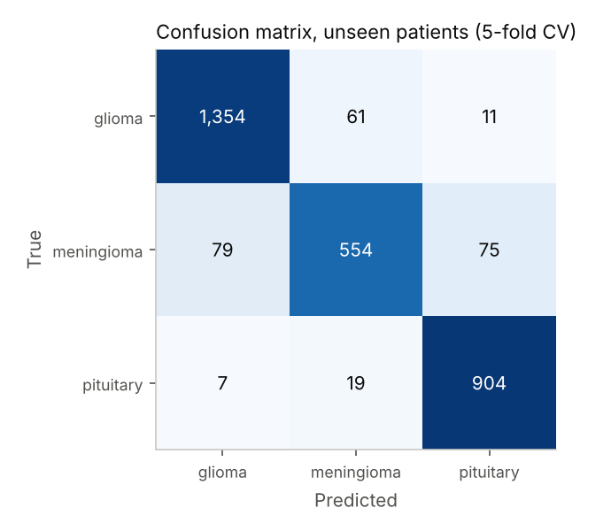
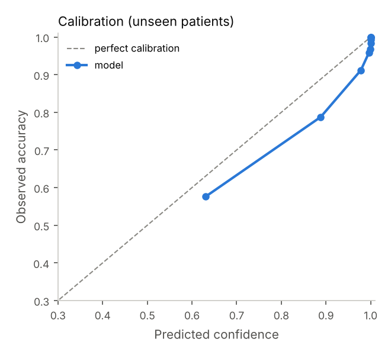
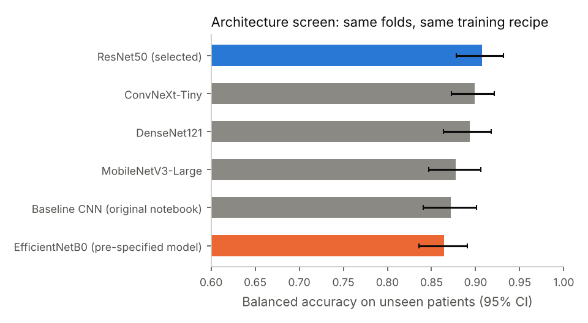
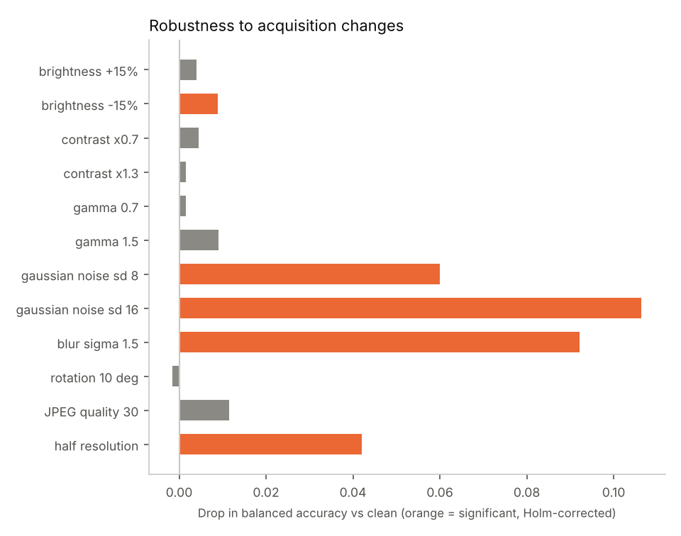
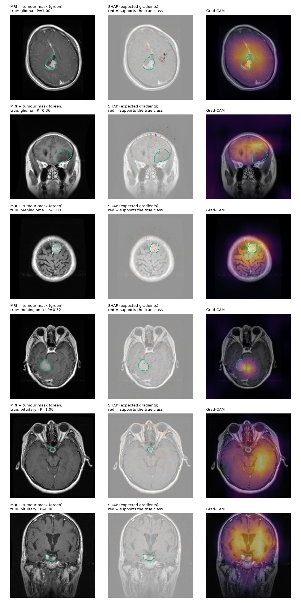
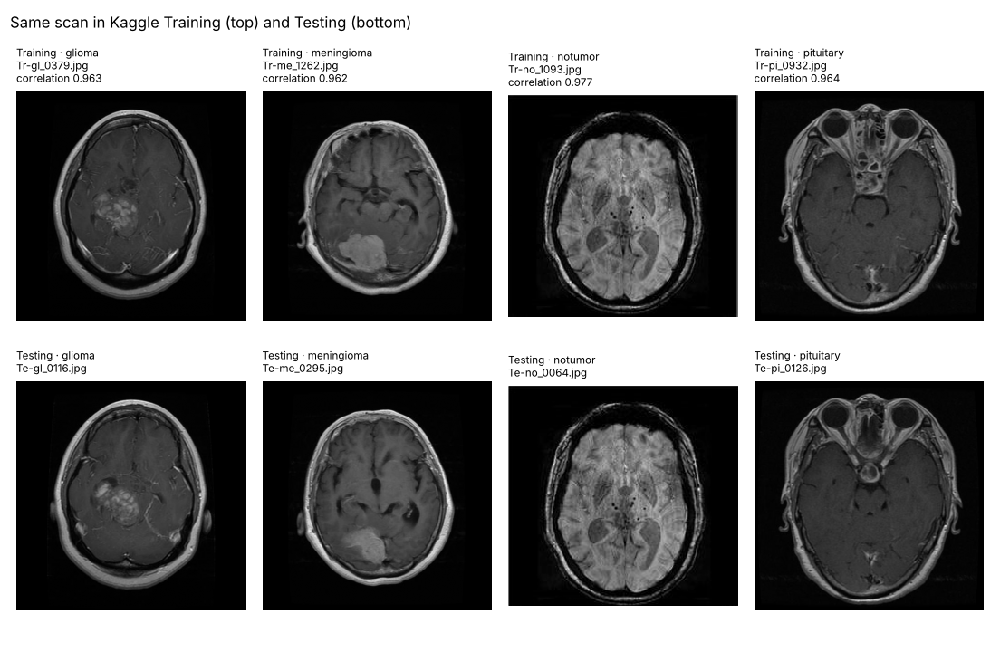
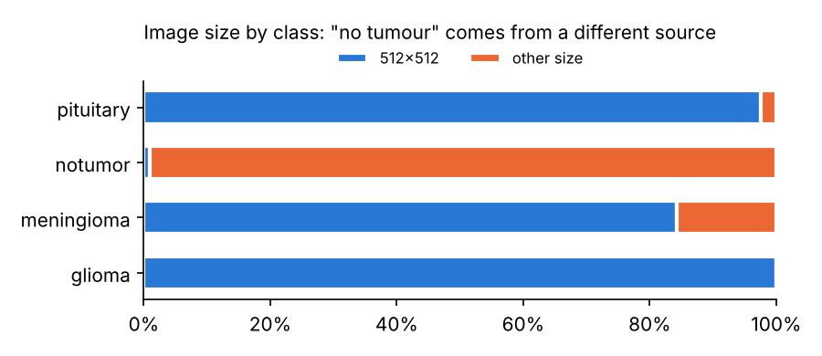

# BrainGuard: brain-tumour MRI classifier validated on unseen patients

[](https://github.com/Muneera-DSA/BrainGuard-MRI-Tumor-Detection/actions/workflows/ci.yml)

> 📓 **Walkthrough notebook:** [`notebooks/walkthrough.ipynb`](notebooks/walkthrough.ipynb) tells the full analysis story step by step, with every table and chart already shown. It reads the saved results, so it opens on GitHub and runs in seconds.

I built a deep-learning classifier that identifies the **tumour type (glioma, meningioma or pituitary tumour) from a single contrast-enhanced T1 MRI slice**, as a second-reader triage aid. It is trained on the figshare dataset of Cheng et al. (3,064 slices from **233 patients**, with patient IDs and radiologists' tumour outlines) and validated with **patient-grouped cross-validation**, so every prediction is for a patient the model never saw.

**What it achieves** (final model: ResNet50, 3,064 predictions on unseen patients):

| | |
|---|---|
| Accuracy | **Balanced accuracy 90.1%** (95% CI 87.2–92.5%), accuracy 91.8%, macro AUC 0.983, Cohen's κ 0.87 |
| Per tumour type | Sensitivity: glioma **95.0%**, pituitary **97.2%**, meningioma **78.2%** (the hardest class) |
| Model selection | 6 architectures compared on the same patient folds. ResNet50 beat the pre-specified EfficientNetB0 by **+3.7 points** of balanced accuracy (95% CI +1.3 to +6.2), confirmed in an independent second training run |
| Calibration | ECE 0.036. When it is at least 99% confident (71% of images) it is right 98.5% of the time |
| Explainability | Grad-CAM and SHAP **scored against the tumour outlines**: attribution falls on the tumour 3.6–3.7× more than chance, and Grad-CAM passes the randomisation sanity check |
| Robustness | Stable under brightness, contrast, gamma, rotation and JPEG changes (≤ 1.1 points); the main risks are image noise (−6 to −11 points), blur (−9) and low resolution (−4) |

**How it was built:** data validation and tumour-mask checks → patient-grouped splitting → transfer learning with two-phase fine-tuning (head, then the top of the backbone) → a 6-architecture screen on identical folds (CNN baseline, EfficientNetB0, ResNet50, DenseNet121, MobileNetV3, ConvNeXt-Tiny) → Holm-corrected hypothesis tests → robustness to 12 acquisition changes → SHAP and Grad-CAM localisation tests with sanity checks → [`MODEL_CARD.md`](MODEL_CARD.md).

**Why patient-level validation matters here.** Public brain-tumour classifiers often report 95–99% accuracy on the popular Kaggle *Brain Tumor MRI Dataset*. I audited that benchmark: **54.2% of its test images have a same-scan copy in its training set**, and 96% of the test images I could trace come from patients it trains on. On clean data, splitting by image instead of by patient inflates balanced accuracy by 5 points (91.6% vs 86.5%). The [benchmark section](#why-patient-level-validation-the-kaggle-benchmark-leaks) shows the evidence.

> **Status:** complete. Every number comes from committed code and saved predictions (full output in [`reports/results.md`](reports/results.md)). GPU runs: [`run_on_colab.ipynb`](notebooks/run_on_colab.ipynb) (main study), [`run_architectures_on_colab.ipynb`](notebooks/run_architectures_on_colab.ipynb) (architecture screen) and [`run_final_model_on_colab.ipynb`](notebooks/run_final_model_on_colab.ipynb) (final model, robustness, explanations).

---

## The model

| | |
|---|---|
| **Task** | Glioma vs meningioma vs pituitary tumour, from one contrast-enhanced T1 slice |
| **Decision supported** | Second-reader triage of tumour type. A research prototype, **not** a diagnostic device (see [`MODEL_CARD.md`](MODEL_CARD.md)) |
| **Data** | figshare, Cheng et al. (CC BY 4.0): 3,064 slices, 233 patients (glioma 1,426 / 89; meningioma 708 / 82; pituitary 930 / 62) |
| **Validation** | 5-fold cross-validation **grouped by patient**: every prediction is for a patient the model never saw. Early stopping uses a separate 15% of the *training* patients, never the evaluation fold |
| **Final model** | ResNet50 (ImageNet), head trained first, then the top 30% of the backbone fine-tuned with BatchNorm frozen; mild anatomy-preserving augmentation. Selected by the architecture screen below |
| **Imbalance** | Class shares 47/23/30%. Metrics are balanced accuracy and per-class sensitivity, not accuracy alone. Class weighting is tested as a hypothesis, not assumed |
| **Uncertainty** | Every CI is a patient-level bootstrap (2,000 draws); paired tests on the same images |

### Results

95% confidence intervals come from a patient-level bootstrap. Source: [`reports/results.md`](reports/results.md).

| Metric | Value (95% CI) |
|---|---|
| Balanced accuracy | **90.1%** (87.2–92.5%) |
| Accuracy | 91.8% (89.3–93.9%) |
| Macro one-vs-rest AUC | 0.983 (0.972–0.991) |
| Macro F1 / Cohen's κ | 0.904 / 0.871 |
| Calibration: ECE / Brier | 0.036 / 0.126 |
| Variation across the 5 folds | accuracy 91.7% ± 1.9% (SD) |

| Tumour type | Images | Sensitivity | Specificity | AUC |
|---|---|---|---|---|
| Glioma | 1,426 | 95.0% (92.2–97.3%) | 94.7% | 0.990 |
| Meningioma | 708 | **78.2% (70.4–84.5%)** | 96.6% | 0.969 |
| Pituitary | 930 | 97.2% (94.5–99.2%) | 96.0% | 0.991 |

<p> </p>

- **Meningioma is the weak point**, and its errors go both ways: 79 slices are called glioma and 75 pituitary. As a second reader, the model should not be used to rule meningioma out.
- **Calibration** is good where it matters most: 71% of images get ≥ 99% confidence, and those are right 98.5% of the time. In the uncertain range it is over-confident (about 71% stated confidence, 60% correct), so probabilities below 90% should be re-calibrated before they are shown to a reader.

### Model selection: six architectures on the same folds

Every backbone uses the same patients in every fold, the same augmentation, head, two-phase fine-tuning and early stopping. EfficientNetB0 was the pre-specified model; the table compares each model with it on the same 3,064 predictions (Δ: patient-level bootstrap; p: paired McNemar, Holm-adjusted within the table).

| Model | Balanced accuracy (95% CI) | Δ vs EfficientNetB0 (95% CI) | McNemar p (Holm) | Macro AUC | Meningioma sensitivity | ECE | Parameters | Minutes per fold (T4) |
|---|---|---|---|---|---|---|---|---|
| ResNet50 (selected) | **90.7%** (87.8–93.2%) | **+4.3** (+2.0 to +6.5) | 5.4e-06 | 0.982 | **85.2%** | 0.053 | 23.6M | 4.7 |
| ConvNeXt-Tiny | 89.9% (87.3–92.1%) | +3.4 (+1.3 to +5.6) | 3.5e-07 | 0.980 | 78.4% | 0.044 | 27.8M | 13.1 |
| DenseNet121 | 89.3% (86.4–91.8%) | +2.9 (+0.9 to +4.9) | 2.3e-05 | 0.977 | 77.0% | **0.032** | 7.0M | 4.6 |
| MobileNetV3-Large | 87.8% (84.7–90.6%) | +1.3 (−0.5 to +3.2) | 0.72 | 0.976 | 75.4% | 0.050 | 3.0M | 1.9 |
| Baseline CNN (original notebook) | 87.2% (84.0–90.1%) | +0.8 (−1.7 to +3.1) | 0.96 | 0.968 | 76.6% | 0.050 | | |
| EfficientNetB0 (pre-specified) | 86.5% (83.5–89.1%) | reference | | 0.971 | 69.9% | 0.045 | | |




- **ResNet50 was selected.** ResNet50, ConvNeXt-Tiny and DenseNet121 all beat EfficientNetB0 (bootstrap intervals exclude zero); MobileNetV3 and the original CNN do not.
- **The selection was checked with a second, independent training run** of ResNet50 on the same folds, the run that produced the final model: balanced accuracy 90.1% vs 90.7% (difference −0.6, CI −2.0 to +0.8), same predicted class for 93.8% of images. Its lead over EfficientNetB0 held: **+3.7 points (CI +1.3 to +6.2)**, and +2.9 over the original CNN (CI +0.3 to +5.4).
- **Meningioma sensitivity moves more between runs** (85.2% vs 78.2%) than overall accuracy does, so it is reported as 78–85%.
- **Cost:** DenseNet121 gets most of the gain with a third of the parameters; ConvNeXt-Tiny trains almost 3× slower than ResNet50 for no gain.
- The final model was chosen on these folds, so its estimate is slightly optimistic; only an external test set removes that bias.

### Hypothesis tests (Holm-corrected)

H1–H3 were pre-specified against EfficientNetB0 and are reported that way. H4 and H6 use the final model.

| # | Hypothesis | Result | p (Holm) | Verdict |
|---|---|---|---|---|
| H1 | Image-level CV overstates accuracy (leakage) | 91.6% vs 86.5% balanced accuracy | 2.9e-22 | **Supported** |
| H2 | Transfer learning (EfficientNetB0) beats the original CNN | 86.5% vs 87.2% | 1.0 | Not supported (ResNet50 does, see above) |
| H3 | Class weighting improves balanced accuracy | 87.6% vs 86.5% | 0.4 | Not supported |
| H4 | Meningioma is detected less reliably | sensitivity −17.6 points (CI −25.4 to −10.8) | 0.002 | **Supported** |
| H5a | Kaggle accuracy is higher when the test image has a copy in Training | 99.3% vs 93.7% | 2.7e-08 | **Supported** |
| H5b | Kaggle accuracy is higher when the test patient is in Training | 97.7% vs 96.6% | 1.0 | Not supported |
| H6 | SHAP attribution concentrates on the tumour more than chance | 4.6% inside vs 1.2% tumour area | 1.7e-25 | **Supported**, see the sanity check |

### Robustness to image quality

Each fold model re-scores its own held-out patients under 12 acquisition changes; each change is paired with the clean image and tested with McNemar (Holm-corrected).

| Change | Drop in balanced accuracy (ResNet50) | EfficientNetB0 |
|---|---|---|
| Brightness ±15%, contrast ×0.7 / ×1.3, gamma, rotation 10°, JPEG quality 30 | ≤ 1.1 points | ≤ 4.0 points |
| Half resolution | **−4.2** | −4.6 |
| Blur (σ 1.5) | **−9.2** | −11.3 |
| Gaussian noise (sd 8 / 16) | **−6.0 / −10.6** | −5.7 / −6.5 |



ResNet50 is steadier than EfficientNetB0 under contrast changes and blur, but **more sensitive to noise**. Noisy, blurred or low-resolution scans are the main deployment risk; only an external test set from another scanner can measure how large it is.

### Do the explanations point at the tumour?

150 held-out images, each explained by the fold model that never saw the patient, scored against the radiologists' tumour masks:

| | SHAP (expected gradients) | Grad-CAM | EfficientNetB0 (SHAP / Grad-CAM) |
|---|---|---|---|
| Median attribution inside the tumour (chance 1.2%) | 4.6% | 4.5% | 3.5% / 2.5% |
| Peak of the map inside the tumour (chance 2.2%) | 42.0% | 28.7% | 32.7% / 20.0% |
| Sanity check: similarity to a random model (low = good) | 0.53, **fails** | −0.06, **passes** | 0.77 / 0.16 |



- **Grad-CAM is the trustworthy explanation here.** Its maps change completely when the learned weights are randomised, so they reflect what the model learned. With ResNet50 it lands on the tumour more often than with EfficientNetB0.
- **SHAP is borderline.** Its maps remain fairly similar for a random model (0.53, just above the 0.5 line), so they partly show image structure (edges, bright tissue). Its attributions are numerically correct: completeness r = 0.89, and it agrees with the `shap` library's `GradientExplainer` (r = 0.57–0.87).
- **Most attribution still lies outside the tumour.** In the figure, Grad-CAM covers the glioma and meningioma cases but spreads widely for pituitary tumours, which suggests the model also uses location and surrounding anatomy. The maps should not be used as tumour localisation.

### What the results mean

1. **About 90% balanced accuracy on new patients is the honest figure** for this task, against the 95–99% common on leaky benchmarks.
2. **Architecture choice mattered more than "transfer learning or not".** EfficientNetB0 was no better than a small CNN; ResNet50 was about 4 points better than both.
3. **Meningioma remains the clinical weak point** (78–85% sensitivity across two runs): the model must not be used to rule it out.
4. **Class weighting is not needed:** the imbalance (47/23/30%) is moderate and re-weighting gave no significant gain (H3).
5. **Image quality is the deployment risk**, noise above all; an external validation set from another scanner is the next step.
6. **Explanations must be tested, not trusted on sight.** Grad-CAM passes its sanity check; SHAP only partly does.

---

## Why patient-level validation: the Kaggle benchmark leaks

All numbers are generated by `python -m brainguard.audit`, `brainguard.shortcut` and `brainguard.crosswalk`. Full tables are in [`reports/`](reports).

### A. Half the test set is already in the training set

Duplicates are detected in two steps:
1. **Candidates:** images whose perceptual hashes are similar.
2. **Confirmation:** a 64×64 pixel correlation of at least 0.95.

Hash similarity alone is not enough. Among hash-similar pairs with correlation below 0.80, half carry different tumour labels; they are different brains. Above 0.95, **1 of 7,609 pairs** disagrees on the label.

| How strictly "the same scan" is defined | Testing images with a copy in Training |
|---|---|
| Identical file bytes | 103 (7.9%) |
| Pixel correlation ≥ 0.995 (visually identical) | 477 (36.4%) |
| **Pixel correlation ≥ 0.95 (same scan, re-saved or resized), the definition used here** | **710 (54.2%)** |



### B. Testing patients are Training patients

Most Kaggle tumour images are re-encoded figshare slices. Matching each one to its figshare original recovers the **patient ID**:
- **114 of the 120 figshare patients in Kaggle Testing also appear in Kaggle Training.**
- **171 of 178 matched Testing images (96%) come from a patient the model trained on.**

This is a lower bound: only identical slices are matched, so neighbouring slices of the same patient are missed ([`reports/kaggle_crosswalk.md`](reports/kaggle_crosswalk.md)).

### C. The labels can be predicted without looking at the brain

The "no tumour" images come from a different source:
- **Different image sizes:** 99% are not 512×512, while every glioma image is.
- **Different MRI sequences:** on visual inspection, mostly T2/FLAIR, while the tumour images are contrast-enhanced T1.

A gradient-boosting model given **only file properties** (width, height, colour mode, file size, no pixels) scores on Kaggle Testing:

| Task | File properties only |
|---|---|
| Tumour vs no tumour | **AUC 0.984** (95% CI 0.978–0.990), accuracy 94.0% |
| One rule: "not 512×512 → no tumour" | accuracy 90.5% |
| 4 classes | accuracy 67.1% (majority class: 30.9%) |



**What this means:**
- A high accuracy on this benchmark is not evidence of tumour recognition.
- The tumour-vs-no-tumour task in particular cannot be validated with this data.
- That is why the model is built on a dataset with patient IDs and a single source, and the claim is restricted to **tumour type**.

---

## Reproduce

**Data audit** (CPU, about 3 minutes; needs the Kaggle zip):

```bash
pip install -e .
# Kaggle zip extracted to data/kaggle/{Training,Testing}
python -m brainguard.audit && python -m brainguard.shortcut
python -m brainguard.figshare          # downloads ~880 MB from figshare and converts it
python -m brainguard.crosswalk
```

**Full study** (GPU): open [`notebooks/run_on_colab.ipynb`](notebooks/run_on_colab.ipynb) in Google Colab with a T4 GPU and run all cells. It takes 1.5–2.5 hours and resumes after a disconnect. Or locally:

```bash
pip install -e ".[dl]"
python -m brainguard.pipeline --kaggle-zip Brain_tumor_Image_dataset.zip
```

**Final model** (GPU, about 1 hour on a T4): [`notebooks/run_final_model_on_colab.ipynb`](notebooks/run_final_model_on_colab.ipynb) retrains ResNet50 with its fold models saved, then runs robustness and explanations on it.

**Architecture screen** (GPU, about 2 hours on a T4): [`notebooks/run_architectures_on_colab.ipynb`](notebooks/run_architectures_on_colab.ipynb), or `python -m brainguard.train --experiments resnet50_patient densenet121_patient mobilenetv3_patient convnext_tiny_patient`.

**Rebuild every result without a GPU:** the run's saved predictions are committed in [`results/`](results).

```bash
python -m brainguard.report --artifacts-dir results --reports-dir /tmp/check   # identical to reports/results.md
```

**Tests:** `pip install -e ".[dev]" && pytest`. Deep-learning tests run on tiny synthetic images when TensorFlow is installed; CI runs both suites.

## Project structure

```
src/brainguard/
  audit.py        duplicates (hash + pixel correlation), label conflicts, source confounding
  shortcut.py     can file properties alone predict the label?
  figshare.py     download + convert the Cheng et al. .mat files (h5py or system libhdf5)
  crosswalk.py    match Kaggle images to figshare slices -> patient IDs -> patient overlap
  splits.py       patient-grouped and image-level folds
  tfdata.py       tf.data pipeline
  models.py       baseline CNN, EfficientNetB0, ResNet50 / DenseNet121 / MobileNetV3 / ConvNeXt for the screen
  train.py        cross-validated experiments, resumable
  robustness.py   acquisition-shift perturbations
  explain.py      SHAP (expected gradients), Grad-CAM, localisation vs masks, sanity check
  stats.py        Wilson, DeLong, McNemar, Fisher, patient bootstrap, ECE, Holm
  report.py       results.md + figures from saved predictions
  pipeline.py     everything, end to end
notebooks/       run_on_colab (main study), run_architectures_on_colab (screen), run_final_model_on_colab (final model), walkthrough
reports/          generated reports and figures
results/          predictions from the GPU run (every image, every fold) and explanation scores
tests/            unit + end-to-end tests (synthetic data)
```

## Relation to my original BrainGuard notebooks

The original notebooks reported 76% (4-class CNN, Kaggle) and 97% (binary CNN, BRISC 2025). Both evaluated on test sets that share scans with training data. The BRISC audit had already flagged 313 test images with near-duplicates in training; with no patient IDs, they could not be removed reliably. This repository replaces those numbers with a protocol under which leakage cannot occur, keeps the original CNN as a baseline, and improves on it with the ResNet50 model (+2.9 points of balanced accuracy on the same patients).

## Data and licences

- **Kaggle *Brain Tumor MRI Dataset*** (M. Nickparvar), described by its author as a compilation of figshare, SARTAJ and Br35H. Images are not redistributed here.
- **figshare** brain tumour dataset, J. Cheng, CC BY 4.0, <https://doi.org/10.6084/m9.figshare.1512427>. Cite: Cheng J. et al., *Enhanced performance of brain tumor classification via tumor region augmentation and partition*, PLoS ONE 10(10), 2015.

---

**Author:** Muneera Mohamed · MSc Data Science · CMA (USA) · [GitHub](https://github.com/Muneera-DSA)
